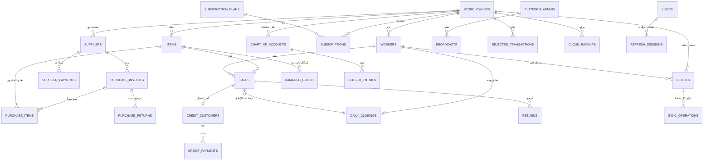

# DATABASE_DESIGN.md — مَقوتي

قاعدة بيانات علائقية (PostgreSQL مقترح هندسياً نظراً لمتطلبات القيد المزدوج والعلاقات المعقدة).

كل الجداول (عدا `platform_admins`, `refresh_sessions`, `subscription_plans`, `devices`, `broadcasts`, `audit_log`, `system_settings`) تحمل عمود `store_owner_id` كمفتاح عزل Tenant إلزامي. لا يُسمح بأي استعلام لا يقيّد بـ `store_owner_id` لبيانات تخص Tenant محدد.

الاصطلاحات:
- كل جدول: `id UUID PRIMARY KEY DEFAULT gen_random_uuid()`.
- `created_at TIMESTAMPTZ NOT NULL DEFAULT now()`, `updated_at TIMESTAMPTZ NOT NULL DEFAULT now()` ما لم يُذكر خلاف ذلك.
- `workers`: حذف الحساب هو Soft Delete (`status='DELETED'` + `deleted_at`)، للحفاظ على سلامة السجلات المحاسبية التاريخية المرتبطة بمبيعاته ومديونياته.
- `items`, `credit_customers`: Soft Delete عادي (`deleted_at`).

---

## 1. طبقة الحسابات والمستخدمين

### `platform_admins`
| عمود | النوع | ملاحظات |
|---|---|---|
| id | UUID PK | |
| full_name | TEXT NOT NULL | |
| phone | TEXT UNIQUE NOT NULL | |
| password_hash | TEXT NOT NULL | Argon2id |
| mfa_secret | TEXT NULL | |
| mfa_enabled | BOOLEAN DEFAULT false | MFA إلزامي للأدمن: يجب إتمام تسجيل المُصدِّق عند أول دخول؛ الحقل يتتبع حالة التسجيل |
| created_at, updated_at | | |

### `store_owners`
| عمود | النوع | ملاحظات |
|---|---|---|
| id | UUID PK | = `Tenant ID` |
| full_name | TEXT NOT NULL | |
| store_name | TEXT NOT NULL | |
| phone | TEXT UNIQUE NOT NULL | وسيلة تسجيل الدخول + مرجع الاشتراك |
| password_hash | TEXT NOT NULL | |
| status | TEXT NOT NULL | ENUM: `TRIAL`, `TRIAL_WARNING`, `TRIAL_EXPIRED`, `ACTIVE`, `EXPIRED`, `SUSPENDED` |
| trial_sales_used | INTEGER NOT NULL DEFAULT 0 | عدّاد مشترك لكل عمال المالك، يزيد طالما `trial_sales_used < trial_sales_limit` |
| trial_sales_limit | INTEGER NOT NULL DEFAULT 100 | يُزرع من `system_settings.trial_sales_limit` عند إنشاء الحساب (snapshot لا يتأثر لاحقاً بتعديل الإعداد العام)؛ يعدّله App Owner لكل مالك على حدة |
| max_workers_allowed | INTEGER NOT NULL DEFAULT 0 | رصيد العمال العاديين الممنوح من App Owner — كل +1 = موافقة على عامل عادي واحد (R-33)؛ العامل المسؤول لا يُحتسب ضمنه |
| temp_password_hash | TEXT NULL | كلمة مرور احتياطية مؤقتة يولّدها App Owner |
| temp_password_generated_at | TIMESTAMPTZ NULL | لحساب انتهاء الصلاحية (24 ساعة افتراضياً) |
| must_change_password | BOOLEAN NOT NULL DEFAULT false | يُفعَّل بعد دخول ناجح بكلمة مرور مؤقتة |
| deleted_at | TIMESTAMPTZ NULL | |
| created_at, updated_at | | |

**فهرس:** `UNIQUE(phone)`, `INDEX(status)`.

### `workers`
| عمود | النوع | ملاحظات |
|---|---|---|
| id | UUID PK | |
| store_owner_id | UUID FK → store_owners(id) NOT NULL | |
| full_name | TEXT NOT NULL | |
| phone | TEXT UNIQUE NOT NULL | اسم الدخول، فريد على مستوى النظام بالكامل |
| password_hash | TEXT NOT NULL | |
| status | TEXT NOT NULL DEFAULT 'ACTIVE' | ENUM: `ACTIVE`, `SUSPENDED`, `DELETED` |
| suspended_manually_before_owner_lock | BOOLEAN DEFAULT false | يحافظ على حالة إيقاف يدوي سابقة عند تجديد اشتراك المالك |
| is_responsible | BOOLEAN NOT NULL DEFAULT false | العامل المسؤول الوحيد؛ يمنح تلقائياً وصولاً لـ: الآجل، الصندوق، النسخ الاحتياطي؛ فريد التفعيل لكل مالك |
| perm_show_cost_price | BOOLEAN DEFAULT false | |
| perm_show_sell_prices_inventory | BOOLEAN DEFAULT false | |
| perm_damaged_goods_entry | BOOLEAN DEFAULT true | |
| perm_reports_access | BOOLEAN DEFAULT false | |
| perm_enter_own_advance | BOOLEAN DEFAULT true | لا أثر للعامل العادي؛ تفعيلها للعامل المسؤول يتيح له دخول شاشة المصروفات (تبويب «سلفتي» فقط) — R-10 |
| last_login_at | TIMESTAMPTZ NULL | آخر دخول ناجح (مصدر حقل `last_login_at` في استجابات Workers) |
| deleted_at | TIMESTAMPTZ NULL | |
| created_at, updated_at | | |

**فهرس:** `INDEX(store_owner_id, status)`.

---

## 2. طبقة الاشتراك والترخيص

### `subscription_plans`
| عمود | النوع | ملاحظات |
|---|---|---|
| id | UUID PK | |
| name | TEXT NOT NULL | "شهر"، "6 أشهر"، "12 شهر"، "مخصص" |
| duration_days | INTEGER NOT NULL | 30 / 180 / 365 / قيمة يحددها App Owner |
| is_custom | BOOLEAN DEFAULT false | |
| is_active | BOOLEAN DEFAULT true | |
| created_at, updated_at | | |

### `subscriptions`
| عمود | النوع | ملاحظات |
|---|---|---|
| id | UUID PK | |
| store_owner_id | UUID FK → store_owners(id) NOT NULL | |
| plan_id | UUID FK → subscription_plans(id) NOT NULL | |
| activated_by | UUID FK → platform_admins(id) NOT NULL | |
| starts_at | TIMESTAMPTZ NOT NULL | |
| expires_at | TIMESTAMPTZ NOT NULL | |
| status | TEXT NOT NULL | ENUM: `ACTIVE`, `EXPIRED`, `CANCELLED` |
| agreed_amount | NUMERIC(12,2) NULL | المبلغ الفعلي المتفق عليه هاتفياً بعد أي خصم (للسجل والتدقيق فقط — لا خصم آلي R-09) |
| created_at | | |

**فهرس:** `INDEX(store_owner_id, status)`, `INDEX(expires_at)`.

### `devices`
| عمود | النوع | ملاحظات |
|---|---|---|
| id | UUID PK | |
| device_fingerprint | TEXT NOT NULL | هوية جهاز متعددة الطبقات |
| store_owner_id | UUID FK → store_owners(id) NULL | |
| worker_id | UUID FK → workers(id) NULL | |
| first_seen_at | TIMESTAMPTZ NOT NULL | |
| last_seen_at | TIMESTAMPTZ NOT NULL | |
| last_sync_at | TIMESTAMPTZ NULL | |
| last_sync_version | BIGINT NOT NULL DEFAULT 0 | آخر رقم إصدار مزامنة استلمه الجهاز (أساس Delta Sync) |
| app_version | TEXT NULL | |
| os | TEXT NULL | |
| status | TEXT NOT NULL DEFAULT 'ACTIVE' | ENUM: `ACTIVE`, `BLOCKED` |
| trial_consumed | BOOLEAN DEFAULT false | يمنع منح تجربة جديدة لنفس الجهاز |
| created_at, updated_at | | |

**فهرس:** `UNIQUE(device_fingerprint)`, `INDEX(store_owner_id)`, `INDEX(worker_id)`.

### `sync_operations`
سجل التحقق من عدم التكرار (Idempotency) لكل عملية واردة من الأجهزة — تُدوَّن قبل التنفيذ.
| عمود | النوع | ملاحظات |
|---|---|---|
| id | UUID PK | |
| store_owner_id | UUID FK NOT NULL | مفتاح عزل Tenant |
| device_id | UUID FK → devices(id) NOT NULL | جهاز الإرسال |
| client_op_id | TEXT NOT NULL | معرّف العملية من الجهاز |
| op_type | TEXT NOT NULL | مثل `SALE`, `DAMAGED_GOODS`, `CREDIT_PAYMENT` |
| status | TEXT NOT NULL | ENUM: `ACCEPTED`, `REJECTED` |
| error_code | TEXT NULL | عند الرفض |
| created_at | | |

**فهرس:** `UNIQUE(store_owner_id, client_op_id)` — إعادة إرسال نفس `client_op_id` تُرجع النتيجة المحفوظة دون إعادة تنفيذ.

### `refresh_sessions`
جلسات التوكنات (تدوير refresh_token وإبطالها عند logout) — لكل أنواع المستخدمين.
| عمود | النوع | ملاحظات |
|---|---|---|
| id | UUID PK | |
| user_type | TEXT NOT NULL | ENUM: `PLATFORM_ADMIN`, `STORE_OWNER`, `WORKER` |
| user_id | UUID NOT NULL | حسب `user_type` |
| device_id | UUID FK → devices(id) NULL | للمالك/العامل |
| token_hash | TEXT NOT NULL | تجزئة refresh_token الحالي (يدعم التدوير والإبطال) |
| expires_at | TIMESTAMPTZ NOT NULL | |
| revoked_at | TIMESTAMPTZ NULL | يُملأ عند logout أو التدوير أو حظر الجهاز |
| created_at | | |

---

## 3. طبقة المخزون والأصناف

### `items`
| عمود | النوع | ملاحظات |
|---|---|---|
| id | UUID PK | |
| store_owner_id | UUID FK NOT NULL | |
| name | TEXT NOT NULL | |
| unit | TEXT NOT NULL | "كيلو"، "ربطة"، "حزمة"... |
| quantity | NUMERIC(12,3) NOT NULL | الكمية المتبقية الحالية |
| cost_price | NUMERIC(12,2) NOT NULL | سعر الشراء |
| sell_price | NUMERIC(12,2) NOT NULL | سعر البيع الحالي |
| entry_date | DATE NOT NULL | ثابت غير قابل للتعديل بعد الإنشاء |
| emergency_price_mode | TEXT NOT NULL DEFAULT 'RANGE_OR_OPEN' | ENUM: `COST_ONLY`, `COST_PLUS`, `RANGE_OR_OPEN` |
| emergency_price_plus_fixed | NUMERIC(12,2) NULL | مبلغ ثابت فوق التكلفة، لنمط `COST_PLUS` |
| emergency_price_plus_percent | NUMERIC(5,2) NULL | نسبة مئوية فوق التكلفة، بديل للمبلغ الثابت |
| emergency_price_min | NUMERIC(12,2) NULL | الحد الأدنى، لنمط `RANGE_OR_OPEN` (NULL = مفتوح) |
| emergency_price_max | NUMERIC(12,2) NULL | الحد الأقصى (اختياري) |
| deleted_at | TIMESTAMPTZ NULL | |
| created_at, updated_at | | |

**فهرس:** `INDEX(store_owner_id, entry_date)`.
**قاعدة سلامة بيانات:** `quantity >= 0`.

---

## 4. طبقة العمليات (المبيعات)

### `sales`
| عمود | النوع | ملاحظات |
|---|---|---|
| id | UUID PK | |
| store_owner_id | UUID FK NOT NULL | |
| worker_id | UUID FK → workers(id) NULL | NULL إذا نفّذ المالك نفسه البيع |
| item_id | UUID FK → items(id) NOT NULL | |
| quantity | NUMERIC(12,3) NOT NULL | |
| amount | NUMERIC(12,2) NOT NULL | |
| payment_type | TEXT NOT NULL | ENUM: `CASH`, `ELECTRONIC`, `CREDIT` |
| wallet_id | UUID FK → wallets(id) NULL | إلزامي فقط عند `ELECTRONIC` |
| deposit_attachment_url | TEXT NULL | إلزامي فقط عند `ELECTRONIC` |
| credit_customer_id | UUID FK → credit_customers(id) NULL | إلزامي فقط عند `CREDIT` |
| is_emergency_sale | BOOLEAN DEFAULT false | |
| emergency_reason | TEXT NULL | إلزامي إن `is_emergency_sale=true` |
| emergency_override_price | NUMERIC(12,2) NULL | سعر الوحدة الفعلي المُدخل يدوياً |
| price_difference_loss | NUMERIC(12,2) NOT NULL DEFAULT 0 | = `(items.sell_price - emergency_override_price) × quantity` إن موجبة |
| daily_closing_id | UUID FK → daily_closings(id) NULL | يُربط عند اعتماد الإغلاق |
| sold_at | TIMESTAMPTZ NOT NULL DEFAULT now() | |
| created_at, updated_at | | |

**قاعدة سلامة بيانات (CHECK):**
- `(payment_type = 'ELECTRONIC' AND wallet_id IS NOT NULL AND deposit_attachment_url IS NOT NULL) OR (payment_type != 'ELECTRONIC')`
- `(payment_type = 'CREDIT' AND credit_customer_id IS NOT NULL) OR (payment_type != 'CREDIT')`

**قواعد عمل على مستوى الخدمة:**
- `payment_type='CREDIT'` من عامل: مرفوض ما لم يكن `is_responsible=true`.
- `is_emergency_sale=true`: يتحقق `emergency_override_price` من سياسة `items.emergency_price_mode`، و`emergency_reason` غير فارغ.
- أي خصم من `items.quantity` يُنفَّذ ضمن معاملة ذرّية بقفل صف صريح (`SELECT ... FOR UPDATE`).

**فهرس:** `INDEX(store_owner_id, worker_id, sold_at)`, `INDEX(daily_closing_id)`.

### `wallets`
| عمود | النوع | ملاحظات |
|---|---|---|
| id | UUID PK | |
| store_owner_id | UUID FK NOT NULL | |
| name | TEXT NOT NULL | "كريمي"، "جيب"، "ون كاش"... |
| is_active | BOOLEAN DEFAULT true | |
| created_at, updated_at | | |

---

## 4.ب طبقة العمليات المرفوضة

### `rejected_transactions`
| عمود | النوع | ملاحظات |
|---|---|---|
| id | UUID PK | |
| store_owner_id | UUID FK NOT NULL | |
| worker_id | UUID FK NULL | من حاول تنفيذ العملية أصلاً |
| attempted_payload | JSONB NOT NULL | نسخة كاملة من بيانات عملية البيع كما وصلت من الجهاز |
| rejection_reason_code | TEXT NOT NULL | حصراً: `CREDIT_LIMIT_EXCEEDED` أو `INSUFFICIENT_STOCK` (R-30 — عمليات البيع فقط؛ أي فشل آخر يُعاد للجهاز) |
| rejection_reason_detail | TEXT NULL | |
| status | TEXT NOT NULL DEFAULT 'PENDING' | ENUM: `PENDING`, `RESOLVED` |
| resolution_action | TEXT NULL | ENUM: `POST_AS_LOSS`, `ADD_CREDIT`, `APPROVE_ADJUSTED_QTY`, `APPROVE_NEGATIVE_STOCK`, `FINAL_REJECT` |
| adjusted_quantity | NUMERIC(12,3) NULL | الكمية المصحَّحة عند `APPROVE_ADJUSTED_QTY` |
| resolved_by | UUID FK → store_owners(id) NULL | |
| resolved_at | TIMESTAMPTZ NULL | |
| created_at | TIMESTAMPTZ NOT NULL DEFAULT now() | |

**فهرس:** `INDEX(store_owner_id, status)`.
**قاعدة عمل:** حسب سبب الرفض (R-30): `CREDIT_LIMIT_EXCEEDED` → `POST_AS_LOSS` (قيد خسارة مباشر) أو `ADD_CREDIT` (سجل آجل فعلي)؛ `INSUFFICIENT_STOCK` → `APPROVE_ADJUSTED_QTY` (تنفيذ البيع بالكمية المصححة) أو `APPROVE_NEGATIVE_STOCK` (تنفيذ البيع كما ورد مع رصيد سالب) أو `FINAL_REJECT` (إغلاق دون تنفيذ). أي خيار لا يطابق سبب الرفض يُرفض بـ `400 DISALLOWED_RESOLUTION_ACTION`.

---

## 5. طبقة التالف

### `damaged_goods`
| عمود | النوع | ملاحظات |
|---|---|---|
| id | UUID PK | |
| store_owner_id | UUID FK NOT NULL | |
| worker_id | UUID FK NULL | |
| item_id | UUID FK → items(id) NOT NULL | |
| quantity | NUMERIC(12,3) NOT NULL | تُخصم فوراً من `items.quantity` |
| is_damaged | BOOLEAN NOT NULL | |
| reason | TEXT NULL | إلزامي إذا `is_damaged = true` |
| photo_url | TEXT NULL | إلزامي إذا `is_damaged = true` |
| recorded_at | TIMESTAMPTZ NOT NULL DEFAULT now() | |
| created_at | | |

**قاعدة سلامة بيانات (CHECK):** `NOT (is_damaged = true AND (reason IS NULL OR photo_url IS NULL))`

---

## 6. طبقة الآجل (الديون)

### `credit_customers`
| عمود | النوع | ملاحظات |
|---|---|---|
| id | UUID PK | |
| store_owner_id | UUID FK NOT NULL | |
| name | TEXT NOT NULL | |
| phone | TEXT NULL | |
| credit_limit | NUMERIC(12,2) NULL | سقف الائتمان، NULL = بلا سقف |
| added_by_worker_id | UUID FK NULL | |
| deleted_at | TIMESTAMPTZ NULL | |
| created_at, updated_at | | |

### `credit_payments`
| عمود | النوع | ملاحظات |
|---|---|---|
| id | UUID PK | |
| store_owner_id | UUID FK NOT NULL | |
| credit_customer_id | UUID FK → credit_customers(id) NOT NULL | |
| amount | NUMERIC(12,2) NOT NULL | |
| payment_method | TEXT NOT NULL | ENUM: `CASH`, `ELECTRONIC` |
| wallet_id | UUID FK NULL | |
| worker_id | UUID FK NULL | |
| daily_closing_id | UUID FK NULL | |
| paid_at | TIMESTAMPTZ NOT NULL DEFAULT now() | |
| created_at | | |

---

## 7. طبقة المصروفات

### `employees`
| عمود | النوع | ملاحظات |
|---|---|---|
| id | UUID PK | |
| store_owner_id | UUID FK NOT NULL | |
| linked_worker_id | UUID FK → workers(id) NULL | ربط اختياري إن كان نفس الشخص عاملاً مسجلاً |
| name | TEXT NOT NULL | |
| monthly_due | NUMERIC(12,2) NOT NULL | |
| deleted_at | TIMESTAMPTZ NULL | |
| created_at, updated_at | | |

### `employee_advances`
| id, store_owner_id, employee_id FK, amount, note, created_at |

### `employee_payments`
| id, store_owner_id, employee_id FK, amount, paid_at, created_at |

### `rent_records`
| id, store_owner_id, amount, payment_method, payer_name, receiver_name, paid_at, created_at |

### `utility_payments`
| id, store_owner_id, utility_type ENUM(`WATER`,`ELECTRICITY`,`INTERNET`,`OTHER`), utility_type_other TEXT NULL, amount, paid_at, created_at |

### `worker_advances`
| id, store_owner_id, worker_id FK NOT NULL, amount, note, recorded_at, created_at |

---

## 8. طبقة المطابقة اليومية والإغلاق

### `daily_closings`
| عمود | النوع | ملاحظات |
|---|---|---|
| id | UUID PK | |
| store_owner_id | UUID FK NOT NULL | |
| worker_id | UUID FK NULL | `NULL` يمثل إغلاق المالك نفسه |
| closing_date | DATE NOT NULL | |
| actual_cash | NUMERIC(12,2) NOT NULL | |
| expected_cash | NUMERIC(12,2) NOT NULL | محسوب: مبيعات نقدية + دفعات آجل نقدية لنفس الحساب واليوم |
| difference | NUMERIC(12,2) GENERATED | `actual_cash - expected_cash` |
| status | TEXT NOT NULL DEFAULT 'OPEN' | ENUM: `OPEN`, `CLOSED` |
| approved_by | UUID FK → store_owners(id) NULL | يُملأ عند `CLOSED` (ذاتياً إن كان إغلاق المالك نفسه) |
| approved_at | TIMESTAMPTZ NULL | |
| created_at, updated_at | | |

**فهرس:** `UNIQUE NULLS NOT DISTINCT (store_owner_id, worker_id, closing_date)` — صيغة `NULLS NOT DISTINCT` (PostgreSQL 15+) ضرورية لأن `worker_id NULL` يمثل إغلاق المالك نفسه، وبدونها لا يمنع القيد تكرار إغلاق المالك في نفس اليوم.

---

## 9. طبقة المحاسبة (Double-Entry)

### `chart_of_accounts`
| id, store_owner_id, code, name, account_type ENUM(`ASSET`,`LIABILITY`,`EQUITY`,`REVENUE`,`EXPENSE`), parent_account_id FK NULL |

حسابات أساسية تُزرع تلقائياً لكل `store_owner` جديد: الصندوق، محافظ إلكترونية (فرعي لكل `wallet`)، ذمم العملاء، المخزون، رأس المال، المبيعات، تكلفة البضاعة المباعة، مصروف أجور، مصروف إيجار، مصروف خدمات، مصروف تالف، خسائر البيع الاضطراري، عجز الصندوق، فائض الصندوق، سلف الموظفين، الأرباح المحتجزة.

### `ledger_entries` (دفتر الأستاذ)
| عمود | النوع | ملاحظات |
|---|---|---|
| id | UUID PK | |
| store_owner_id | UUID FK NOT NULL | |
| entry_date | DATE NOT NULL | |
| reference_type | TEXT NOT NULL | `SALE`, `CREDIT_PAYMENT`, `EXPENSE`, `DAMAGED_GOODS`, `CLOSING`, `RETURN`, `EMERGENCY_SALE_LOSS`, `REJECTED_TRANSACTION_RESOLUTION` |
| reference_id | UUID NOT NULL | |
| account_id | UUID FK → chart_of_accounts(id) NOT NULL | |
| debit | NUMERIC(12,2) NOT NULL DEFAULT 0 | |
| credit | NUMERIC(12,2) NOT NULL DEFAULT 0 | |
| description | TEXT NULL | |
| created_at | | Append-only |

**قاعدة سلامة بيانات:** مجموع `debit` = مجموع `credit` لكل `reference_id` واحد.
**فهرس:** `INDEX(store_owner_id, entry_date)`, `INDEX(reference_type, reference_id)`, `INDEX(account_id)`.

### `returns`
| id, store_owner_id, sale_id FK → sales(id) NOT NULL, quantity, amount, returned_at, worker_id FK NULL, created_at |
— العامل يستطيع تسجيل مرتجع فقط لعملية `sale.worker_id` يطابق هويته؛ المالك لأي عملية. **قيد زمني (R-20):** المرتجع مسموح حصراً لعملية بيع من نفس اليوم الحالي وقبل اعتماد إغلاق ذلك اليوم — مرتجع ليوم سابق أو ليوم معتمد يُرفض قطعياً (`400 RETURN_DAY_PASSED` / `409 DAY_ALREADY_CLOSED`). عند الإنشاء: يُضاف `quantity` تلقائياً لـ `items.quantity`، ويُنشأ قيد عكسي.

---

## 10. طبقة الرسائل والإعلانات والعروض

### `broadcasts`
| عمود | النوع | ملاحظات |
|---|---|---|
| id | UUID PK | |
| created_by | UUID FK → platform_admins(id) NOT NULL | |
| type | TEXT NOT NULL | ENUM: `POPUP`, `NOTIFICATION`, `OFFER`, `ADVERTISEMENT`, `STICKY_BANNER` |
| title | TEXT NOT NULL | |
| body | TEXT NOT NULL | |
| image_url | TEXT NULL | |
| button_text | TEXT NULL | |
| button_url | TEXT NULL | |
| duration_hours | INTEGER NOT NULL DEFAULT 0 | 0 = حتى الإيقاف اليدوي |
| expires_at | TIMESTAMPTZ NULL | |
| dismissible | BOOLEAN DEFAULT true | |
| priority | TEXT NOT NULL DEFAULT 'NORMAL' | ENUM: `NORMAL`, `HIGH` |
| target_type | TEXT NOT NULL | ENUM: `ALL`, `SPECIFIC_DEVICE`, `TRIAL`, `ACTIVE`, `EXPIRED` |
| target_device_id | UUID FK → devices(id) NULL | |
| discount_code | TEXT NULL | فقط لـ `OFFER`، يُحفظ Upper-case |
| discount_percent_text | TEXT NULL | |
| is_active | BOOLEAN DEFAULT true | |
| views_count | INTEGER DEFAULT 0 | |
| clicks_count | INTEGER DEFAULT 0 | |
| created_at, updated_at | | |

### `broadcast_acks`
| id, broadcast_id FK, device_id FK, ack_type ENUM(`VIEW`,`CLICK`), acked_at |

---

## 11. طبقة سجل التدقيق

### `audit_log`
| عمود | النوع | ملاحظات |
|---|---|---|
| id | UUID PK | |
| actor_type | TEXT NOT NULL | ENUM: `PLATFORM_ADMIN`, `STORE_OWNER`, `WORKER`, `SYSTEM` |
| actor_id | UUID NULL | |
| action_type | TEXT NOT NULL | انظر القائمة الكاملة في `13-authentication-security.md` |
| target_type | TEXT NULL | |
| target_id | UUID NULL | |
| old_value | JSONB NULL | |
| new_value | JSONB NULL | |
| ip_address | TEXT NULL | |
| device_info | TEXT NULL | |
| result | TEXT NOT NULL | ENUM: `SUCCESS`, `FAILURE` |
| failure_reason | TEXT NULL | |
| created_at | TIMESTAMPTZ NOT NULL DEFAULT now() | Append-only |

**فهرس:** `INDEX(actor_id)`, `INDEX(target_type, target_id)`, `INDEX(created_at)`.

---

## 12. طبقة إعدادات النظام

### `system_settings`
| key TEXT PK, value JSONB, updated_at |

مفاتيح أساسية: `trial_sales_limit`, `trial_warning_threshold`, `contact_phone`, `whatsapp_message_default`, `trial_expired_message`, `subscription_expired_message`, `account_suspended_message` (رسالة الإيقاف الإداري لشاشة القفل), `default_emergency_price_mode` (الإعداد الافتراضي العام لسياسة البيع الاضطراري عند إضافة صنف جديد — R-14), `min_sync_interval_hours` (افتراضي 6، ويُمنع ضبطه بأكثر من 12 ساعة حفاظاً على أرضية R-26: مرتين يومياً على الأقل), `temp_password_validity_hours`.

---

## 13. طبقة النسخ الاحتياطي السحابي

### `cloud_backups`
| عمود | النوع | ملاحظات |
|---|---|---|
| id | UUID PK | |
| store_owner_id | UUID FK NOT NULL | |
| file_url | TEXT NOT NULL | |
| size_bytes | BIGINT NOT NULL | |
| tenant_binding_hash | TEXT NOT NULL | تجزئة مشتقة من `store_owner_id`، مُضمَّنة داخل الملف نفسه؛ تُفحص إلزامياً عند أي استيراد |
| created_at | TIMESTAMPTZ NOT NULL DEFAULT now() | |

**فهرس:** `INDEX(store_owner_id, created_at)`.
**قاعدة عمل:** متاح حصراً لحسابات `status=ACTIVE` (نشطة مشتركة) — للحسابات التجريبية تظهر نافذة `BACKUP_PAYWALL_MODAL` بدل المحتوى (R-28)، وللحسابات غير النشطة (منتهية/موقوفة) محظور كلياً بموجب القفل العام (R-23).

---

## 13.5 جداول المشتريات والموردين والعملة (R-38..R-43)

- **توسعات الجداول القائمة:**
  - `store_owners`: إضافة `currency` (`YER` | `SAR` | `USD`، افتراضي `YER`) و`default_costing_method` (`WEIGHTED_AVERAGE` | `LAST_PRICE` | `FIFO`، افتراضي `WEIGHTED_AVERAGE`) و`allow_responsible_purchases` (`BOOLEAN DEFAULT false` للتحكم بصلاحية المشتريات والموردين للعامل المسؤول R-38).
  - `wallets`: إضافة `account_code TEXT NULL` للربط بالحساب الفرعي `11xx` في دليل الحسابات.
  - إضافة `wallet_settled BOOLEAN NOT NULL DEFAULT false` و`wallet_settlement_id UUID FK NULL` على كافة حركات المحافظ الإلكترونية الـ 11 لتتبع التسوية والمطابقة مع المزود.
  - `sales`: إضافة `cogs_amount DECIMAL(12,2) NULL` لحفظ تكلفة البضاعة المباعة الفعلية لكل عملية بيع (خصوصاً عند استهلاك طبقات `FIFO` أو تغير التكلفة منتصف اليوم).
  - `LedgerReferenceType`: إضافة `PURCHASE`, `PURCHASE_VOID`, `SUPPLIER_OPENING_BALANCE`, `PURCHASE_PAYMENT`, `PURCHASE_RETURN`, `OWNER_DEPOSIT`, `OWNER_WITHDRAWAL`, `WALLET_SETTLEMENT`, `EXPENSE_SETTLEMENT`.
  - `chart_of_accounts`: زراعة ودعم الحسابات القياسية:
    - `2000 — الموردون / الذمم الدائنة (LIABILITY)`
    - `2100 — مصروفات مستحقة (LIABILITY)` (المصروفات الآجلة غير المسددة)
    - `3100 — جاري المالك (مسحوبات وإيداعات المالك) (EQUITY)` (معزول عن الأرباح التشغيلية)
    - `5700 — مصروفات أخرى (EXPENSE)` (مصروفات المحل التشغيلية كالأكياس والثلج مستقلة عن الخدمات 5300)

- **`owner_transactions` (إيداعات ومسحوبات المالك — R-46):**
  - `id UUID PK`, `store_owner_id UUID FK`, `type ('DEPOSIT'|'WITHDRAWAL')`, `amount DECIMAL(12,2) > 0`, `payment_method ('CASH'|'ELECTRONIC')`, `wallet_id UUID FK NULL`, `attachment_url`, `note`, `wallet_settled`, `wallet_settlement_id`, `transacted_at TIMESTAMPTZ`.

- **`wallet_settlements` (مطابقة وتسوية المحافظ الإلكترونية — R-46):**
  - `id UUID PK`, `store_owner_id UUID FK`, `wallet_id UUID FK`, `book_balance_before`, `actual_provider_balance`, `difference`, `cash_out_to_drawer`, `book_balance_after`, `settled_operations_count INT`, `status ('MATCHED'|'DISCREPANCY_RESOLVED')`, `notes`, `settled_at TIMESTAMPTZ`.

- **`expense_settlements` (سداد المصروفات المستحقة — R-47):**
  - `id UUID PK`, `store_owner_id UUID FK`, `target_type ('RENT'|'UTILITY'|'SALARY')`, `rent_record_id`, `utility_payment_id`, `employee_payment_id`, `amount DECIMAL(12,2) > 0`, `payment_method ('CASH'|'ELECTRONIC')`, `wallet_id UUID FK NULL`, `attachment_url`, `note`, `wallet_settled`, `paid_at TIMESTAMPTZ`.

- **`suppliers` (الموردون):**
  - `id UUID PK`, `store_owner_id UUID FK NOT NULL`, `name`, `phone`, `address`, `contact_person`, `tax_number`, `notes`, `opening_balance DECIMAL(12,2)`, `opening_balance_settled DECIMAL(12,2)`, `current_balance DECIMAL(12,2)`, `credit_limit DECIMAL(12,2)`, `payment_terms_days INT`, `status ('ACTIVE'|'SUSPENDED')`, `deleted_at TIMESTAMPTZ`.
  - فهارس فريدة جزئية (`WHERE deleted_at IS NULL`) لعدم تكرار الاسم أو الهاتف ضمن نفس المتجر، وقيود `CHECK` تمنع الأرصدة السالبة.

- **`purchase_invoices` (فواتير المشتريات):**
  - `id UUID PK`, `store_owner_id UUID FK`, `supplier_id UUID FK`, `invoice_number` (فريد لكل متجر `PUR-YYYYMMDD-NNNN`), `supplier_invoice_ref`, `invoice_date DATE`, `due_date DATE`, `payment_type ('CASH'|'ELECTRONIC'|'CREDIT'|'PARTIAL')`, `wallet_id UUID FK NULL`, `subtotal`, `tax_amount`, `discount_amount`, `total_amount`, `paid_amount`, `settled_amount`, `remaining_amount`, `currency`, `attachment_url`, `notes`, `status ('DRAFT'|'POSTED'|'VOIDED')`, `costing_method_used`, `daily_closing_id UUID FK NULL`, `posted_at`, `voided_at`, `void_reason`.

- **`purchase_items` (بنود الفاتورة وطبقات FIFO):**
  - `id UUID PK`, `purchase_invoice_id UUID FK`, `store_owner_id UUID FK`, `item_id UUID FK NULL`, `item_name`, `base_unit`, `unit`, `conversion_factor DECIMAL(12,4)`, `quantity DECIMAL(12,3)`, `base_quantity DECIMAL(12,3)`, `unit_cost_price`, `tax_amount`, `discount_amount`, `total_line_cost`, `effective_base_unit_cost`, `sell_price`, `remaining_fifo_qty DECIMAL(12,3)`, `returned_quantity DECIMAL(12,3)` (`CHECK (returned_quantity <= quantity)`).

- **`supplier_payments` (سندات سداد الموردين):**
  - `id UUID PK`, `store_owner_id UUID FK`, `supplier_id UUID FK`, `purchase_invoice_id UUID FK NULL`, `amount DECIMAL(12,2) > 0`, `payment_method ('CASH'|'ELECTRONIC')`, `wallet_id UUID FK NULL`, `receipt_attachment_url`, `notes`, `daily_closing_id UUID FK NULL`, `paid_at TIMESTAMPTZ`.

- **`purchase_returns` (مرتجعات المشتريات):**
  - `id UUID PK`, `store_owner_id UUID FK`, `purchase_invoice_id UUID FK`, `purchase_item_id UUID FK`, `supplier_id UUID FK`, `item_id UUID FK`, `quantity`, `base_quantity`, `unit_price`, `total_amount`, `refund_method ('DEBT_REDUCTION'|'CASH_REFUND')`, `reason`, `daily_closing_id UUID FK NULL`, `returned_at TIMESTAMPTZ`.

---

## 14. ERD مختصر (Mermaid)

---

*نهاية الملف. التالي: `API_SPEC.md` و `openapi.yaml`.*
